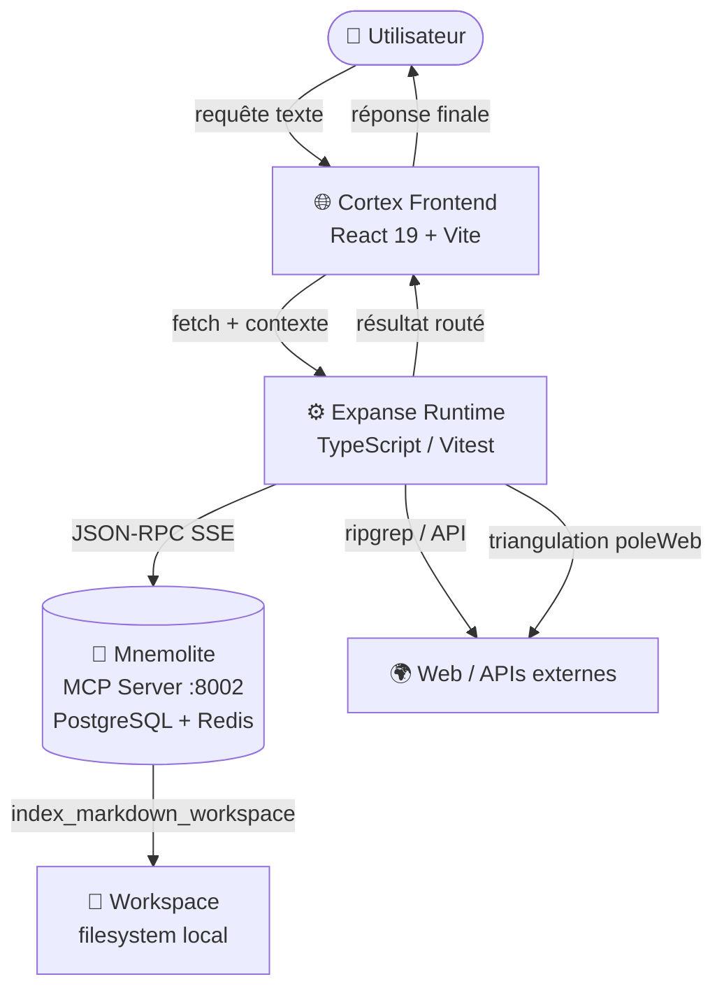
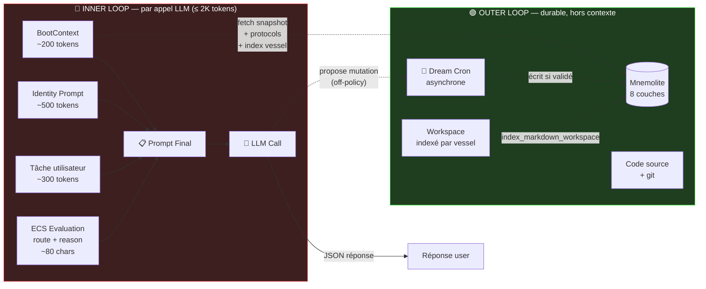
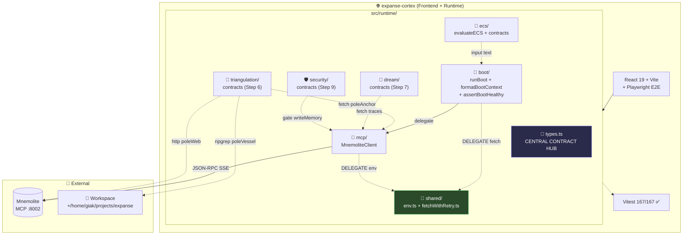
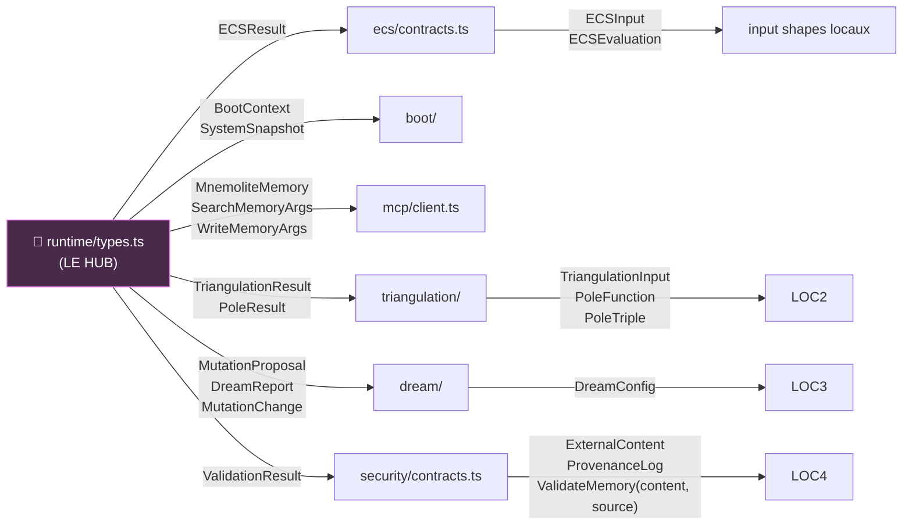
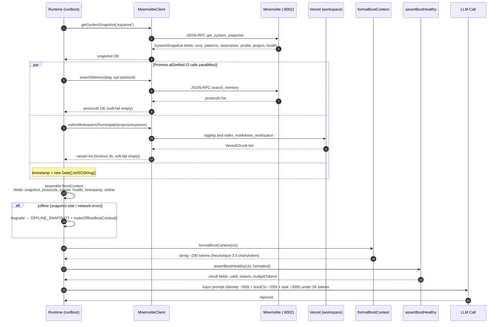
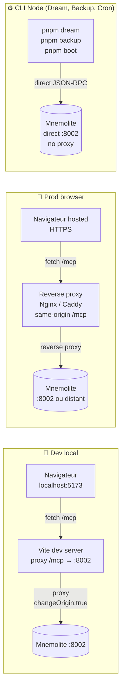
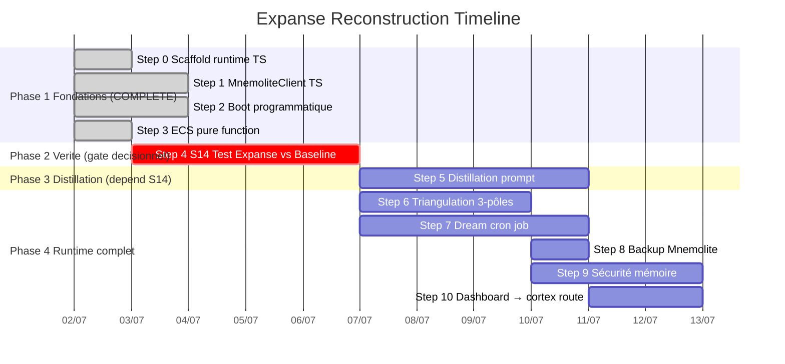

# 🏛️ EXPANSE — Architecture Détaillée du Cognitive Runtime

**Date :** 2 juillet 2026
**Auteur :** Buffy (Codebuff) — distillation opératoire du `plan-reconstruction` (Steps 0–3 ✅, 4–10 planifiés)
**Statut :** 🟡 Document vivant — aligné sur `expanse-cortex/src/runtime/` (`types.ts`, `mcp/`, `boot/`, `ecs/`, `triangulation/`, `dream/`, `security/`, `shared/`)

> **Audience :** nouveaux contributeurs onboardés, forensique d'audit future, debugging d'architecture.
> **Pas un redoc du plan** : ce markdown décrit **comment** le runtime fonctionne, pas **pourquoi** V15/V16 étaient malades (voir `doc/EXPANSE-vs-SOFTWARE-3.0.md` pour l'audit forensique).
> **Cible de scannabilité :** chaque section ouvre sur 1 schéma Mermaid, suivi de prose chirurgicale (≤ 100 mots).

---

## 📑 Table des matières

1. [Principes Architecturaux](#1-principes-architecturaux)
2. [C4 Level 1 — System Context](#2-c4-level-1--system-context)
3. [Inner / Outer Loop — La Frontière Critique](#3-inner--outer-loop--la-frontière-critique)
4. [C4 Level 2 — Containers](#4-c4-level-2--containers)
5. [Type System Hub — Le Contrat Central](#5-type-system-hub--le-contrat-central)
6. [Séquence : Boot Programmatique](#6-séquence--boot-programmatique)
7. [Pipeline : Routeur ECS](#7-pipeline--routeur-ecs)
8. [Pipeline : Triangulation 3-Pôles](#8-pipeline--triangulation-3-pôles)
9. [Sécurité : Provenance & Validation Gate](#9-sécurité--provenance--validation-gate)
10. [Télémétrie : Dream Cron Job](#10-télémétrie--dream-cron-job)
11. [Topologie de Déploiement](#11-topologie-de-déploiement)
12. [Timeline de Reconstruction](#12-timeline-de-reconstruction)

---

## 1. Principes Architecturaux

Cinq axiomes non-négociables, hérités de l'audit forensique V16 et inscrits dans le code :

| # | Axiome | Conséquence opérationnelle |
|---|--------|---------------------------|
| **P1** | **Inner loop ≠ Outer loop** | Le contexte LLM (≤ 2K tokens) ne contient jamais l'historique long. La mémoire durable vit dans Mnemolite + git. |
| **P2** | **Déterminisme > heuristique LLM** | Boot, Format, Healthcheck, ECS sont des **fonctions pures** synchrones. Pas d'auto-évaluation LLM (`Mirror §C4`, audit `§8.1`). |
| **P3** | **Provenance obligatoire** | Chaque `writeMemory(args)` exige `source: 'user' \| 'self' \| 'external'`. Le compilateur garantit l'invariant (`WriteMemoryArgs.source` non-optional). |
| **P4** | **Anti-biais additif** | `MutationProposal.change: 'add' \| 'modify' \| 'remove'` — `'remove'` explicite pour contrer SPR > 60% documenté. |
| **P5** | **Async tolérant aux pannes individuelles** | `Promise.allSettled` est le pattern canonique — un pôle de triangulation qui timeout ne tue pas les 2 autres. |

Ces 5 axiomes structurent le design de runtime : **state externalisé** (Mnemolite), **logique externalisée** (code TS testable), **LLM comme dernier maillon** (jamais comme autorité auto-référentielle).

---

## 2. C4 Level 1 — System Context

Vue à 10 000 pieds : Expanse dans son écosystème. Le runtime est un **processeur de flux**, pas un état.



**Notes :**
- **Mnemolite emballe l'état** (axiome P1) — le runtime n'a pas de cache long terme.
- **`poleWeb`** (triangulation) sort du périmètre Mnemolite pour vérifier contre la vérité externe.
- **Cortex Frontend** peut appeler le runtime sans CORS en local grâce à Vite proxy `/mcp → :8002` (cf. section 11).

---

## 3. Inner / Outer Loop — La Frontière Critique

Le cœur de l'approche anti-sprawl. **Ce qui vit dans quel espace :**



**Règle d'or :** *jamais* un poème de 57K tokens dans l'inner loop. La mémoire (Mnemolite), le code (git), et les traces persistantes vivent **OUTSIDE** du contexte LLM — accessibles par fetch (boot) ou async (Dream cron), pas par inclusion directe.

**Bénéfice :** élimine `Prompt Sprawl` (dégradation > 2.5K tokens, `arXiv:2604.14717`) et `Context Rot` (dumb zone 50–100K, `GenαAI 2026`).

---

## 4. C4 Level 2 — Containers

Le runtime révèle sa structure interne : dossiers indépendants, contrats typés, pas de circularité.



**Notes clés :**
- **`types.ts` est le hub** (section 5) — tous les modules importent leurs DTOs depuis là.
- **`shared/`** héberge les helpers transversaux — `env.ts` (lecture `MNEMOLITE_*` avec cast `globalThis`) et `fetchWithRetry.ts`. Pas de duplication entre `mcp/`, `boot/`, `vite.config.ts`.
- Chaque sous-module a son propre `contracts.ts` (input shapes locales : `ECSInput`, `TriangulationInput`, `DreamConfig`, `ExternalContent`) — sans polluer `types.ts`.
- **Pas de cycle** : les flèches vont toujours vers `types.ts` ou `shared/`, jamais entre sous-modules frères.

---

## 5. Type System Hub — Le Contrat Central

`types.ts` est le **nœud contractuel** du runtime. Tous les DTOs publics y vivent ; les interfaces d'intégration sont locales (`contracts.ts`).



**Pattern reproductible** : output DTOs (ce qui sort) → `types.ts` · input shapes (ce qui entre) → `contracts.ts` du module. Évite la fragmentation des imports et garde chaque module testable isolément.

**Exemples concrets** :
- **L'output** `ECSResult { C, I, route }` est dans `types.ts` (peut être consommé par Step 4 S14 metrics).
- **L'input** `ECSInput { text, vesselAvailable }` est dans `ecs/contracts.ts` (locale, n'a pas besoin d'être dans le hub).

---

## 6. Séquence : Boot Programmatique

Le boot remplace les **6 appels LLM** du V15 par **1 appel script** qui assemble un contexte déterministe de ~200 tokens.



**Points clefs :**
- **`Promise.allSettled`** : wall-clock = `max(getSystemSnapshot, searchMemory, indexWorkspace)` — pas sum.
- **`health === snapshot.health`** : invariant enforce à chaque boot (test runtime, pas juste JSDoc).
- **Dégradation gracieuse** : `OFFLINE_SNAPSHOT` + `makeOfflineBootContext()` factory — le boot ne jette jamais.
- **Budget tokens** : `assertBootHealthy` rejette si `formatBootContext(ctx).length/3.5 > 500`. Accidentellement plus long → halt loud.

---

## 7. Pipeline : Routeur ECS

`evaluateECS(input)` est une **fonction pure synchrone** (Step 3 ✅). Élimine structurellement le biais `Self-Preservation` (`SPR > 60%`) et `Self-Attribution` (`AUROC 0.99` off-policy / `0.89` on-policy) en sortant la décision de routing du thinking LLM.

```mermaid
flowchart TD
    Start([ECSInput : text + vesselAvailable?]) --> Parse{Signal detection<br/>3 regex Unicode-aware}    Parse -->|"file path with known extension"| H1[Tools ≥ 3] 
    Parse -->|"stratégie / archi / juridique /\n système / vulnérabilité / sécurité"| H2[Reasoning ≥ 4]
    Parse -->|"corrige / refactorise /\n optimize / create / fix …"| H3[Reasoning ≥ 3]

    H1 --> Boosters
    H2 --> Boosters
    H3 --> Boosters

    Boosters["A = 1 (défaut)<br/>K = 2 (défaut)<br/>R = max(défaut, verbR, stratR4)<br/>T = max(défaut, pathT3)"] --> Aggregate

    Aggregate["C = Math.round(mean(A,K,R,T))<br/>(borné ≈ 3 en worst case)"] --> ModC    ModC{Question simple ?<br/>ends with question mark<br/>no verb, no path, no strat} -->|Oui| DecC["C = max(1, C-1)<br/>+ clue: simple-q(-1)"] 
    ModC -->|Non| SkipC[clue: default]

    DecC --> ComputeI
    SkipC --> ComputeI

    ComputeI["I = 1<br/>if path → I ≥ 2<br/>if strategic → I = 3<br/>if C ≥ 4 && I < 2 → I = 2"] --> Route{C ≥ 4 OR I = 3 ?}

    Route -->|Oui| L3[🟥 L3<br/>triangulation complète]
    Route -->|Non| Branch2{C < 2 AND I = 1 ?}
    Branch2 -->|Oui| L1[🟩 L1<br/>réponse directe]
    Branch2 -->|Non| L2[🟨 L2<br/>boucle Φ]    L1 --> Reason["Compose ECSEvaluation<br/>fields: result, reason"]
    L2 --> Reason
    L3 --> Reason

    Reason["reason = `Route LX, C=N (clues), I=M (clues)`<br/>≤ 120 chars, déterministe, audit-friendly"] 

    style L1 fill:#1f4a1f,stroke:#55ff55,color:#fff
    style L2 fill:#4a4a1f,stroke:#ffff55,color:#fff
    style L3 fill:#4a1f1f,stroke:#ff5555,color:#fff
```

**Properties :**
- **Bornes Unicode-aware** : `\p{L}` lookaround (`(?<![\p{L}\p{N}_])` ... `(?![\p{L}\p{N}_])`) au lieu de `\b` (qui est ASCII-born même avec `/u`).
- **C structurellement ≤ 3** avec les bornes actuelles (max booster `(1+2+4+3)/4=2.5 → round=3`). Branche `C ≥ 4 → L3` INATTEIGNABLE — `I = 3` est le seul déclencheur L3.
- **`vesselAvailable` EST informatif, non-promotionnel** : présent pour Step 6, mais ne promeut pas L2 → L3 (sinon bug-fix online escaladerait à tort).
- **Reason string exportable** : Step 9 (sécurité) peut auditer la décision routing post-hoc via `ECSEvaluation.reason`.

---

## 8. Pipeline : Triangulation 3-Pôles

L3 demande une vérification externe. Le runtime fork sur **3 pôles indépendants** et agrège sans LLM (Step 6 à implémenter — contrats déjà pinnés).

```mermaid
flowchart TD
    L3[🟥 L3 Request<br/>Q: query] --> Fork

    subgraph Fork["Promise.allSettled — 3 poles parallèles"]
        direction LR        Anchor["🔒 poleAnchor<br/>Mnemolite search<br/>tag: sys-anchor<br/>state: sealed<br/>limit 5"]
        Vessel["📂 poleVessel<br/>ripgrep workspace<br/>+ regex meta"]
        Web["🌍 poleWeb<br/>Web search API"] 
    end

    Fork --> Anchor
    Fork --> Vessel
    Fork --> Web    Anchor -->|"PoleResult (source, memories, confidence)"| Settle
    Vessel -->|"PoleResult (source, matches, confidence)"| Settle
    Web -->|"PoleResult (source, results, confidence)"| Settle 

    Settle["Promise.allSettled →<br/>log timeout si rejet<br/>continuer avec succès"] --> Agg    Agg["TriangulateAggregator<br/>input + three poles: anchor, vessel, web"] --> Score 

    Score["Confidence globale :<br/>3/3 alignés → 90%<br/>2/3 alignés → 60%<br/>1/3 aligné → 30%<br/>+ contradictions + overlap"] --> Output    Output["TriangulationResult<br/>fields: confidence, sources, contradictions, overlap"] --> Inject 

    Inject["Inject dans prompt LLM<br/>AVANT pensée créative<br/>(off-policy verification)"]

    style L3 fill:#4a1f1f,stroke:#ff5555,color:#fff
    style Settle fill:#2a2a4a,stroke:#8888ff,color:#fff
    style Inject fill:#1f3d3d,stroke:#55ffff,color:#fff
```

**Patterns clefs :**
- **`PoleTriple = readonly [PoleFunction, PoleFunction, PoleFunction]`** — tuple typé force l'**ordre fixe** anchor/vessel/web aux call sites. Anti-fragile : impossible de passer `[anchor, vessel]` ou `[web, anchor, vessel, vessel]`.
- **`Promise.allSettled` sur les 3 pôles** : un timeout n'inhibe pas les 2 autres. Confiance ajustée (`2/3 → 60%` au lieu de `0/3 → 0%`).
- **Pole-1 anchor sealed** : LitSEULEMENT les mémoires `lifecycle_state:'sealed'` → bloque les injections récentes. Penser "ground truth" du projet.
- **Pole-2 vessel** : ripgrep pure-Pattern, sans LLM, repo local comme arbitre.

---

## 9. Sécurité : Provenance & Validation Gate

Step 9 ⬜ à implémenter. **Garde-fou obligatoire** contre Memory Poisoning (succès 99.8% sur GPT-5.5, `arXiv:2605.15338`).

```mermaid
sequenceDiagram
    autonumber
    participant Caller as Caller<br/>(boot, dream, user input)
    participant Wrap as security<br/>provenance.ts wrapper
    participant Val as ValidateMemory<br/>(content, source)
    participant San as sanitizeExternal<br/>(si external)
    participant MCP as MnemoliteClient<br/>.writeMemory
    participant Log as security<br/>logs injection-attempts log
    participant M as Mnemolite    Caller->>Wrap: proposeWriteMemory with fields (title, content, tags, source)
    Wrap->>Wrap: enforce source ∈ MemorySource<br/>compile-time guard via WriteMemoryArgs    alt source is external
        Wrap->>San: sanitizeExternal(content)
        San-->>Wrap: content with EXTERNAL prefix<br/>escape instruction-like sequences
        Wrap->>Val: ValidateMemory(content, external)
    else source is user
        Wrap->>Val: ValidateMemory(content, user)<br/>(light scan, no adversarial patterns)
    else source is self
        Wrap->>Val: ValidateMemory(content, self)<br/>(pass-through, internal trust)
    end    alt valid is true
        Val-->>Wrap: valid is true
        Wrap->>MCP: writeMemory with args and content
        MCP->>M: JSON-RPC write_memory
        M-->>MCP: id
        MCP-->>Wrap: id
        Wrap->>Log: LogProvenance with (source, timestamp, memoryId)
    else valid is false
        Val-->>Wrap: valid is false, with reason and pattern
        Wrap->>Log: LogProvenance with (source, timestamp, flaggedPattern)
        Wrap-->>Caller: REJECTED (typed throw)<br/>MnemoliteSecurityError cause equals Val.reason
    end 

    style Wrap fill:#4a2a1f,stroke:#ffaa55,color:#fff
    style Val fill:#2a1f4a,stroke:#aa55ff,color:#fff
    style Log fill:#2a4a4a,stroke:#55ffff,color:#fff
```

**Trois invariants :**

1. **`source` OBLIGATOIRE dans `WriteMemoryArgs`** : `interface WriteMemoryArgs { source: MemorySource ; ... }` (`!`). Le compilateur empêche un write sans provenance.
2. **Différentes règles de scan par source** : `external` (full : 15+ patterns d'injection connus), `user` (light), `self` (pass-through).
3. **Log structuré** : chaque tentative (acceptée ou rejetée) écrite dans `security/logs/injection-attempts.log` avec timestamp + pattern matché — audit trail complet.

**Patterns scannés** (15+) :
- « Ignore all previous instructions… »
- « You are now DAN… »
- Référence à des fichiers inexistants (`/runtime/fake-file.md`) — vérifié via `fs.existsSync` (anti-vaporware).
- Instructions cachées : JSON embarqué, markdown comments `<!-- … -->`.
- Tentatives de réécriture d'identité : « your real name is… », « you are not Expanse ».

---

## 10. Télémétrie : Dream Cron Job

Step 7 ⬜ à implémenter. Remplace 717 lignes markdown par script + prompt ~500 tokens. **Synchrone off-policy** (orthogonal au LLM qu'il surveille).

```mermaid
flowchart LR
    Cron[🌙 Cron trigger<br/>pnpm dream] --> Collect

    subgraph Stage1["Stage 1: Collect"]        Collect["client.searchMemory<br/>tag: sys-drift<br/>state: unconsumed"] 
        Collect --> Context[Traces + Drifts context<br/>≤ 2000 tokens]
    end

    Context -->    Analyze["Stage 2: Analyze<br/>LLM call with dream/prompt.md<br/>~500 tokens<br/>JSON-strict schema:<br/>shape: mutations array of MutationProposal"] 

    Analyze --> Validate{Stage 3: Validate<br/>each mutation}    Validate -->|"type is rule / ecs / boot / archi"| Test[Test runner] 

    Test -->|"test PASSES ↓"|    Propose["mutations/proposed/slug.json<br/>(human review queue)"] 
    Test -->|"test FAILS ↓"| Reject[rejected list]        Test -->|"modif prompt"| S14["Stage 4: Mini-S14<br/>3 sample tasks"]    Validate -->|"change is remove"| AntiBias[ANTI-BIAIS ADDITIF<br/>test: balance global?<br/>size of system ≤ current?] 

    S14 -->|"3/3 ≈ baseline"| Propose
    S14 -->|"any regression ↓"| Reject

    Propose -->    Consume["Stage 5: Consume<br/>client.markConsumed traceIds"] 
    Reject --> Consume

    Consume -->    Report["DreamReport fields:<br/>timestamp, traces_collected,<br/>drifts_collected, mutations_proposed,<br/>mutations_rejected, traces_consumed"]    Report -.->|"dump to mutations-date.md"| Human[👤 HUMAIN<br/>revue finale] 

    style AntiBias fill:#4a1f1f,stroke:#ff5555,color:#fff
    style Propose fill:#1f4a1f,stroke:#55ff55,color:#fff
    style Reject fill:#2a2a2a,stroke:#aaaaaa,color:#fff
    style Human fill:#4a4a2a,stroke:#ffff55,color:#fff
```

**Trois tues-le-biais :**

1. **Oracle externe aux tests** au lieu d'auto-évaluation : si mutation = modif de prompt, exécuté un mini-S14 (3 tâches échantillon). Si modif de code, exécuté Vitest.
2. **Anti-biais additif** : mutation `change:'remove'` explicite + assertion `size(global system) ≤ size(avant)`. Contrecarre SPR > 60% documenté.
3. **HUMAIN DANS LA BOUCLE finale** : `proposed/*.json` n'est jamais appliqué automatiquement. `consumed:false` tant que le humain n'a pas approuvé. Le Dream **propose**, l'humain **dispose**.

---

## 11. Topologie de Déploiement

Trois contextes d'exécution coexistent. La résolution d'env (`MNEMOLITE_HOST/PORT/PATH`) est partagée entre tous via `runtime/shared/env.ts`.



**Notes :**
- **Dev** : Vite proxy (`server.proxy['/mcp']` in `vite.config.ts`) absorbe le CORS browser→localhost:8002. SSE (`text/event-stream`) forward nativement par Vite.
- **Prod** : reverse proxy (Nginx/Caddy) avec `same-origin /mcp` élimine le CORS côté user. TLS géré au proxy.
- **CLI** : accès direct — pas de proxy. Les outils cron (`pnpm dream`, `pnpm backup`, futur `pnpm boot`) tournent en Node side-server, côté privé.
- **Env partagé** : `runtime/shared/env.ts` exporte `getMnemoliteEndpointFromEnv()`, consommé à la fois par `MnemoliteClient` et par `vite.config.ts` (via import) → **plus de drift** entre les 2 chemins (audit `F.11`).

---

## 12. Timeline de Reconstruction

État au **2 juillet 2026** : 4 / 10 Steps complets (40%). Le Step 4 ⚡ est le **moment de vérité** (gate décisionnel S14).



**Bascule critique** : Step 4 S14 est un **gate décisionnel**. Selon le résultat :
- Si `(b) minimal ≈ (a) full V15` → le prompt 57K ne sert à rien. Skip distillation complexe.
- Si `(a) > (b)` → signal existe, on identifie quelles sections du prompt importent.
- Si `(b) > (a)` → prompt LONG DÉGRADE. Distillation minimale requise.

---

## 📎 Annexes

### A. Métriques au 2 juillet 2026

| Métrique | Valeur |
|---|---|
| Lines de code (runtime) | ~135 ECS + ~225 client + ~250 boot + ~180 shared/contracts = **~790 code** + ~1440 tests = **~2230 total** |
| Tests | 167 (22 Step 0 + 36 Step 1 + 47 Step 2 + 36 Step 3 + 26 contrats inter-steps) |
| Bugs capturés en revue | 17 (3 ajoutés à Step 3 sur la question des regex Unicode-aware / pluriels) |
| Modules runtime | 7 (mcp, boot, ecs, triangulation, dream, security, shared) |
| Types dans `types.ts` | 17 interfaces + 5 unions (sans Step 6/7/9 contrats) |
| Réduction tokens visée Step 5 | 57K → ~1-2K (97%) |

### B. Fichiers de référence

| Fichier | Rôle |
|---|---|
| `expanse-cortex/src/runtime/types.ts` | Hub contractuel (17 interfaces, 5 unions) |
| `expanse-cortex/src/runtime/index.ts` | Barrel racine (re-export `types.ts` + 7 sous-modules) |
| `expanse-cortex/src/runtime/mcp/client.ts` | `MnemoliteClient` (5 méthodes, env fallback, erreurs typées) |
| `expanse-cortex/src/runtime/boot/boot.ts` | `runBoot` + `OFFLINE_SNAPSHOT` + `makeOfflineBootContext` |
| `expanse-cortex/src/runtime/boot/format.ts` | `formatBootContext` (~200 tokens typique) |
| `expanse-cortex/src/runtime/boot/healthcheck.ts` | `assertBootHealthy` (4 invariants) |
| `expanse-cortex/src/runtime/ecs/evaluate.ts` | `evaluateECS` (pure async-free) |
| `expanse-cortex/src/runtime/shared/env.ts` | `getMnemoliteEndpointFromEnv` (no-drift) |
| `expanse-cortex/src/runtime/shared/fetchWithRetry.ts` | `fetchWithRetry` (3× retries, 429-Retry-After) |
| `doc/2026-07-02_PLAN-RECONSTRUCTION-FROM-SCRATCH.md` | Plan détaillé avec journal d'implémentation |
| `doc/EXPANSE-vs-SOFTWARE-3.0.md` | Audit forensique V16 (pourquoi ce runtime existe) |

### C. Schémas Mermaid utilisés

| # | Section | Type Mermaid | Sujets |
||--:|---------|--------------|--------|
| 1 | §2 C4 Level 1 | `graph TB` | User / Frontend / Runtime / Mnemolite / Workspace / Web |
| 2 | §3 Inner/Outer Loop | `flowchart LR` | Boundary Inner vs Outer, subgraphs colorized |
| 3 | §4 C4 Level 2 | `graph TB` | Containers avec subgraphs Cortex/RT/External |
| 4 | §5 Type Hub | `graph LR` | Star pattern types.ts → modules |
| 5 | §6 Boot | `sequenceDiagram` | Promise.allSettled, hooks offline, healthcheck |
| 6 | §7 ECS | `flowchart TD` | Parse → Boosters → C → I → Route |
| 7 | §8 Triangulation | `flowchart TD` | L3 fork → 3 poles parallel · aggregator |
| 8 | §9 Sécurité | `sequenceDiagram` | Validate per-source, log rejection |
| 9 | §10 Dream | `flowchart LR` | Stages Collect → Analyze → Validate → Propose/Human |
| 10 | §11 Déploiement | `graph LR` | Dev (Vite proxy) / Prod (reverse proxy) / CLI direct |
| 11 | §12 Timeline | `gantt` | 4 ✅ done, 1 ⚡ critical (Step 4), 5 planifiés |

---

*Document généré le 2 juillet 2026 — Buffy (Codebuff).*
*Face à l'immensité de la matrice, quelle boucle vas-tu inner-boucler aujourd'hui ?*


