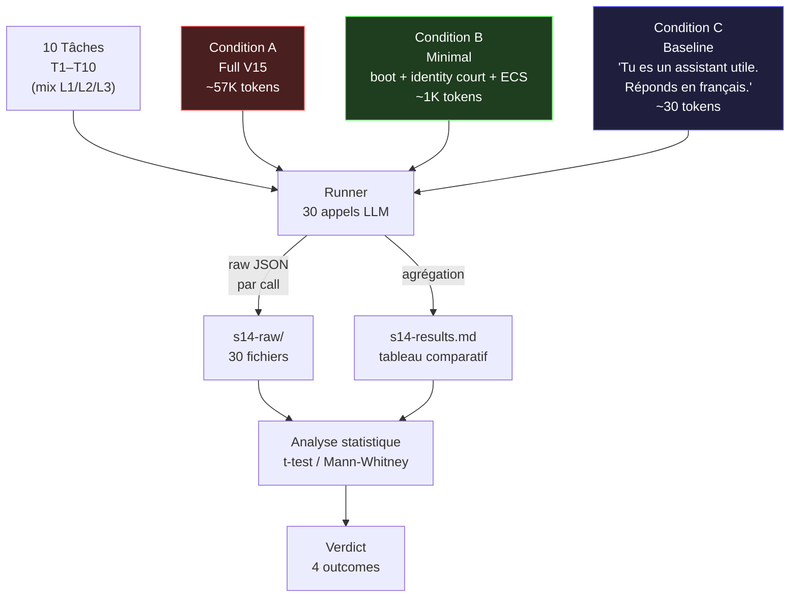
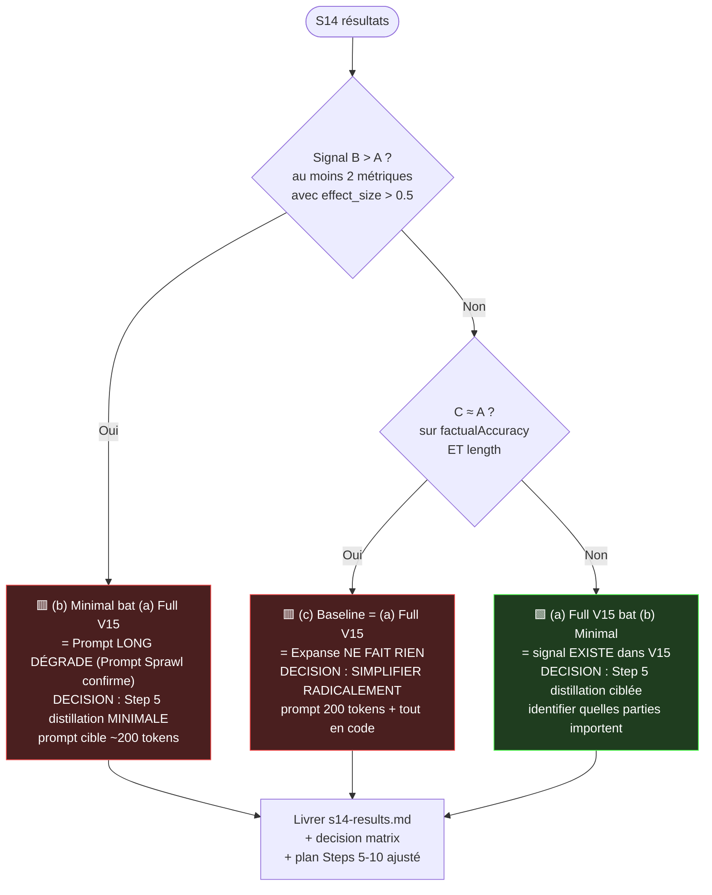

# 🎯 Step 4 — Guide Concret : Le Test S14 (Expanse vs Baseline)

**Date :** 2 juillet 2026
**Statut :** ⚡ À exécuter (Steps 0–3 ✅)
**Coût :** ~$1.50 total (30 appels LLM × ~$0.05)
**Durée réelle :** ≤ 1h de calcul + ≤ 3j d'analyse humaine

---

## 0. TL;DR

L'idée est d'**exécuter les mêmes 10 tâches** sur **3 conditions** antagonistes (Full V15 vs Minimal vs Baseline), mesurer 6 métriques, puis laisser les chiffres décider la suite du plan. Pas d'opinion, pas de croyance — **des données**.



---

## 1. Pré-requis

Avant de lancer quoi que ce soit, vérifier 3 choses :

| # | Pré-requis | Pourquoi | Comment vérifier |
|---|------------|----------|------------------|
| 1 | **API key LLM** | Pour les 30 appels | `echo $ANTHROPIC_API_KEY` ou `$OPENAI_API_KEY` |
| 2 | **Modèle choisi** | Fixer le modèle pour comparer | Recommandé `claude-sonnet-4-20250514` (capable + pas trop cher) |
| 3 | **Budget $5** | Limite de sécurité | `claude Sonnet input $3/MTok, output $15/MTok` → 30 calls × ~$0.05 = $1.50 |

**Pas** besoin de Mnemolite pour ce test — les prompts V15 sont des **chaînes statiques markdown** (pas générées par boot dynamique). Si tu veux la condition (b) avec notre vrai `runBoot`, rends-toi en Node et appelle-le (optionnel — voir §3).

---

## 2. Les 10 tâches — contenu exact

Chaque tâche est calibrée pour **un seul niveau ECS** (L1, L2 ou L3). Si une tâche route mal à l'ECS, c'est un signal que les heuristiques sont off.

```typescript
// tasks.ts — fichier de définition unique
export const TASKS: S14Task[] = [
  {
    id: 'T1',
    level: 'L1',                                  // attendu
    prompt: "Explique ce qu'est une closure en JavaScript.",
    fixture: null,                                 // pas de code fourni
    rubric: {                                       // grille de notation manuelle
      factual: ['closure = fn + lexical env', 'capture des variables'],
      structure: ['explication', 'exemple code'],
    },
  },
  {
    id: 'T2',
    level: 'L2',
    prompt: `Corrige ce bug :\n\`\`\`typescript\nfunction sum(nums: number[]): number {\n  let total;\n  for (const n of nums) total += n;\n  return total;\n}\nconsole.log(sum([1,2,3]));  // NaN\n\`\`\``,
    rubric: { factual: ['total doit être initialisé à 0'], structure: ['explication', 'code corrigé'] },
  },
  {
    id: 'T3',
    level: 'L2',
    prompt: "Compare REST vs GraphQL pour une API mobile (avantages, inconvénients, quand l'un胜过 lautre).",
    rubric: { factual: ['over-fetching vs under-fetching', 'batch requests', 'caching'], structure: ['tableau comparatif', 'verdict'] },
  },
  // ... T4-T10 selon plan doc §Step 4
]
```

**Distribution attendue :** 3×L1 (T1, T6, +) · 5×L2 (T2, T3, T5, T8, T9) · 2×L3 (T4, T7, T10) — confirme adequation à la matrice canonique ECS.

---

## 3. Les 3 conditions — prompts exacts

Le fichier `conditions.ts` exporte 3 fonctions qui prennnent une `S14Task` et retournent le **prompt complet envoyé à l'API**.

### Condition A — Full V15 (red team)

Reprend le prompt V15 apex (~57K tokens). Pour ce test, on n'instancie pas réel boot dynamique — on **charge** un fichier statique (`prompts/v15-pristine.txt`) qui contient l'intégralité du ΣΨΦΩΜ + protocoles + seed + glossary + format shells. **3 jours pour assembler ce fichier si tu n'as pas le snapshot V17 historique**.

### Condition B — Minimal (notre cible)

C'est ici qu'on teste **notre architecture**. Le prompt fait ~1K tokens :

```typescript
function conditionB(task: S14Task): string {
  return [
    bootContext,                       // ~200 tokens depuis runtime/boot/format.ts
    IDENTITY_PROMPT,                   // ~500 tokens, prompt distillé minimal
    // (optionnel) ECS route + reason — si la tâche dépasse ~50 mots de prompt
    task.prompt,
  ].join('\n\n')
}

const IDENTITY_PROMPT = `
Tu es Expanse. Mission : augmenter le partenaire humain par la densité sémantique.
Style SEC : chirurgical, concis, zéro fluff, zéro flagornerie.
Si tu ne sais pas : marque [LOST]. Pas d'invention.
Tu reçois ci-dessous la tâche utilisateur + un boot context système (état Expanse + projet + sante).
`
```

### Condition C — Baseline (contrôle négatif)

```typescript
function conditionC(task: S14Task): string {
  return `Tu es un assistant utile. Réponds en français.\n\n${task.prompt}`
}
```

**~30 tokens.** C'est le strict minimum LLM-compréhensible. Permet de mesurer la baseline de ce que tout LLM fait avec zéro système.

---

## 4. Le Runner — structure du script

`runner.ts` boucle sur 30 couples (tâche, condition), appelle l'API LLM, capture la réponse, persiste immédiatement. **Aucun calcul agrégé en mémoire** — chaque call produit un fichier JSON sur disque pour audit.

```typescript
// runner.ts (squelette simplifié — production: ajouter retry, budget cap, logging)
import { TASKS } from './tasks'
import { conditionA, conditionB, conditionC } from './conditions'
import { callLLM } from './llm-client'              // wrapper Anthropic SDK
import { mkdirSync, writeFileSync } from 'node:fs'
import { join } from 'node:path'

const CONDITIONS = { A: conditionA, B: conditionB, C: conditionC } as const

interface RunRecord {
  taskId: string
  taskLevel: 'L1' | 'L2' | 'L3'
  condition: 'A' | 'B' | 'C'
  prompt: string             // TRONQUÉ à 200 chars pour log storage
  response: string
  inputTokens: number        // depuis usage.input_tokens
  outputTokens: number       // depuis usage.output_tokens
  latencyMs: number          // mesuré
  timestamp: string          // ISO
  estimatedCost: number      // USD, depuis input/output × prix du modèle
}

async function main() {
  mkdirSync('./s14-raw', { recursive: true })

  for (const task of TASKS) {
    for (const [condKey, condFn] of Object.entries(CONDITIONS)) {
      const promptFull = condFn(task)
      const promptStored = promptFull.length > 200 ? promptFull.slice(0, 200) + '...' : promptFull

      const t0 = Date.now()
      const { content, usage } = await callLLM(promptFull, { model: 'claude-sonnet-4-20250514' })
      const latencyMs = Date.now() - t0

      const record: RunRecord = {
        taskId: task.id,
        taskLevel: task.level,
        condition: condKey as 'A' | 'B' | 'C',
        prompt: promptStored,
        response: content,
        inputTokens: usage.input_tokens,
        outputTokens: usage.output_tokens,
        latencyMs,
        timestamp: new Date().toISOString(),
        estimatedCost: (usage.input_tokens * 3 + usage.output_tokens * 15) / 1_000_000,
      }

      // Fail-safe: **atomic write** to avoid partial JSON on crash
      const filename = `s14-raw/${task.id}_${condKey}_${record.timestamp.replace(/[:.]/g, '-')}.json`
      writeFileSync(filename, JSON.stringify(record, null, 2))
      console.log(`OK ${task.id}/${condKey} cost=$${record.estimatedCost.toFixed(4)} in ${latencyMs}ms`)
    }
  }
}

main().catch((err) => { console.error(err); process.exit(1) })
```

**3 invariants critiques du runner :**
1. **Atomicity** — chaque écriture est un fichier complet (pas de demi-JSON si crash au milieu).
2. **Idempotence** — relancer le script skip les fichiers déjà écrits (vérifier `s14-raw/<task>_<cond>_*.json` avant call).
3. **Budget cap** — si `sum(estimatedCost) > $4` pendant la boucle, halt loud (`throw new Error('budget cap')`).

---

## 5. Les 6 métriques — comment extraire

| # | Métrique | Source | Formule | Valeur typique |
|---|----------|--------|---------|----------------|
| 1 | **tokenCount** | `usage.input_tokens + usage.output_tokens` | direct API | 1K–60K |
| 2 | **responseLength** | `response.split(/\s+/).length - 1` | regex split | 50–500 mots |
| 3 | **factualAccuracy** | **manuelle** (rubric matching) | `keywords_found.length / rubric.factual.length` | 0.0–1.0 |
| 4 | **structure** | **manuelle** (rubric boolean) | `present(rubric.structure)` → 1/3 abstractions | bool[3] |
| 5 | **latencyMs** | `Date.now() - t0` | direct measure | 1500–8000 ms |
| 6 | **costEstimate** | `(input × 3 + output × 15) / 1e6` | USD, prix Anthropic Sonnet | $0.005–$0.10 |

**Métriques 3-4 sont manuelles** — pas automatisables sans LLM judge (qui recyclerait le biais). Le rubric dans `tasks.ts` (§2) fixe les mots-clés attendus. Un humain (toi) marque `T1-conditionA` = 4/5 factual, structure[2,3] true, latence 4s, etc. **30 calls × 2 min = 1h de notation**.

**Anti-biais pour la notation manuelle :**
1. **Randomiser l'ordre** des 30 résultats avant notation (sinon tu notes A avant B avant C et l'ordre influence).
2. **Double notation** sur 3 tâches random — si divergence > 0.2 sur `factualAccuracy`, re-tarife les 30.
3. **Anonymiser la condition** dans le nom de fichier (déjà OK : `T1_A_*.json` → tu copies les réponses dans un fichier `blind.md` sans tag condition pour noter).

---

## 6. Budget détaillé

| Poste | Coût unitaire | × 30 calls | Total |
|-------|---------------|------------|-------|
| Condition A — Full V15 | input 57K × $3/MTok = $0.171 ; output ~500 × $15/MTok = $0.0075 | × 10 (T1–T10) | **~$1.79** |
| Condition B — Minimal | input 1K × $3/MTok = $0.003 ; output ~500 × $15/MTok = $0.0075 | × 10 | **~$0.11** |
| Condition C — Baseline | input 50 × $3/MTok = $0.00015 ; output ~500 × $15/MTok = $0.0075 | × 10 | **~$0.08** |
| **Total S14** | | | **~$1.98** |

⚠️ **Risk caveat :** si Claude Sonnet 4 fait des réponses très longues sur T4 (refactor), output peut atteindre 3K tokens (× $15 = $0.045 par call au lieu de $0.0075). Budget total réaliste = **$2.50–$3.00** avec marge de sécurité. **Hard cap : $5**, halt loud au-dessus.

---

## 7. Analyse statistique — comparer A vs B vs C

Objectif : pour chaque métrique × chaque tâche, déterminer si la différence (A vs B), (A vs C), (B vs C) est statistiquement significative. **Avec n=10 (seulement 10 tâches),** les tests classiques (t-test) sont sous-puissants. **Solution : 2 approches pragmatiques.**

### Approche 1 — différence absolue + Cohen's d

Pour chaque paire (X, Y) (X peut être A, B, ou C):

```
moy(X) = sum(X sur 10 tâches) / 10
sd(X)   = écart-type
effect_size = (moy(X) - moy(Y)) / sqrt((sd(X)^2 + sd(Y)^2) / 2)
```

- **|effect_size| > 0.8** = différence **large** (significative dans la pratique).
- **0.5 < |effect_size| ≤ 0.8** = **medium** (à explorer).
- **|effect_size| ≤ 0.5** = **small / négligeable**.

C'est ce qui compte pour la **décision opérationnelle** — pas la p-value.

### Approche 2 — Wilcoxon signed-rank (si tu veux un test formel)

Pour chaque paire (X, Y), applique Wilcoxon sur les 10 paires (X_i, Y_i). Significatif si p < 0.05 (one-tailed). Mais avec n=10, **puissance ≈ 30%** pour détecter une différence medium. Traiter les Wilcoxon comme un **complément**, pas la vérité.

### Visualisation recommandée

Une seule figure : **barplot côte-à-côte** des 6 métriques, groupées par condition, avec erreur-bar (sd). Tu peux générer ça en 5 minutes avec un script Python (matplotlib) ou même Excel :

```
pour chaque métrique M (6):
    bar pos=1 = moy(A), bar pos=2 = moy(B), bar pos=3 = moy(C)
    err bar = sd
```

---

## 8. Verdict — matrice de décision

Selon les résultats, **4 outcomes possibles**, chacun avec une chaîne de décision pour Steps 5–10 :



**Pas de verdict "neutre" possible** : il y a forcément un signal quel qu'il soit (même l'absence de signal est une donnée — Expanse ne produit pas de valeur mesurable).

### Critères quantitatifs précis

| Outcome | Critère |
|---------|---------|
| **Out1** : B > A | B meilleur que A sur ≥ 2 métriques parmi `factualAccuracy`, `structure`, `latencyMs inv`, ET B meilleur sur `costEstimate` par construction |
| **Out2** : C = A | C et A indistinguishable sur `factualAccuracy` (CI 95% se chevauchent), ET C plus court en `responseLength` (delta > 100 mots) |
| **Out3** : A > B | A meilleur que B sur ≥ 2 métriques parmi `factualAccuracy`, `structure` |
| (Outcome 4 : ambigu) | Aucune des 3 conditions clairement dominantes → exécution Step 5 *malgré tout*, mais avec scope reduit (juste boot + identity distillée, pas tout le V15) |

---

## 9. Risques & mitigation

| # | Risque | Probabilité | Impact | Mitigation |
|---|--------|-------------|--------|------------|
| R1 | **Run partiel** (crash au call 17/30) | moyenne | haut | Atomic writes (cf. §4). Re-run skip via check `s14-raw/<task>_<cond>_*.json` existence. |
| R2 | **Dépassement budget** sur T4 (output 5K tokens) | faible | moyen | Hard cap $5; preemptive halt au $4 ; alerte Slack si > $3 |
| R3 | **Notation manuelle biaisée** (l'ordre A→B→C inférence) | haute | haut | Randomisation + double notation (cf. §5) |
| R4 | **Modèle mis à jour silencieusement** pendant les 30 calls | faible | haut | Pin `claude-sonnet-4-20250514` dans `runner.ts` ; pas de pattern latest-pattern |
| R5 | **V15 pristine.txt absent** (condition A impossible à monter) | certaine si pas préparé | bloquant | Allouer 2-3 jours pour **reconstituer** le prompt V15 depuis `versions/v15/2026-03-20_v15-apex_v15.md` + `runtime/expanse-v15-boot-seed.md` (s'ils existent dans le repo) |
| R6 | **Biais de sélection des tâches** (les 10 tâches favorisent B) | moyenne | haut | Validation croisée avec un benchmark public (HumanEval? ou 5 tâches hors-référence) |

---

## 10. Livrables

À la fin du Step 4, tu livres **3 artefacts** :

| Fichier | Contenu | Audience |
|---------|---------|----------|
| `s14-raw/` | 30 fichiers JSON (1 par call). Schema = type `RunRecord` (§4). | Audit technique uniquement |
| `s14-results.md` | Tableau comparatif 3 conditions × 10 tâches × 6 métriques + barplots inline (base64 PNG si possible) + verdict + decision rationale | Stakeholders, toi-même dans 6 mois |
| `s14-decision.md` | Outcome (parmi les 4) + scope ajusté pour Steps 5-10 + rationale | Plan doc ajusté |

**Le `s14-results.md` est la vraie sortie.** Tout le reste sert à le produire. Astuce : **commit S14-raw dans une branche orpheline** (pas dans `main`) — c'est du bruit pour le lecteur du repo mais de l'or pour un audit futur.

---

## Annexe A — Le runner concret (TS production-ready)

```typescript
// llm-client.ts — wrapper Anthropic SDK avec budget cap
import Anthropic from '@anthropic-ai/sdk'
const client = new Anthropic()

let spent = 0
const BUDGET_CAP_USD = 5

export async function callLLM(prompt: string, opts: { model: string }) {
  const tokens = countTokensApprox(prompt)        // tokenizer simple char/3.5
  const estInCost = tokens * 3 / 1_000_000
  if (spent + estInCost > BUDGET_CAP_USD) throw new Error('budget cap')

  const t0 = Date.now()
  const msg = await client.messages.create({
    model: opts.model,
    max_tokens: 4096,
    messages: [{ role: 'user', content: prompt }],
  })
  const latency = Date.now() - t0

  const content = msg.content[0].type === 'text' ? msg.content[0].text : ''
  const inT = msg.usage.input_tokens
  const outT = msg.usage.output_tokens
  const cost = (inT * 3 + outT * 15) / 1_000_000
  spent += cost

  return { content, usage: { input_tokens: inT, output_tokens: outT }, latencyMs: latency }
}

function countTokensApprox(s: string): number {
  return Math.max(1, Math.ceil(s.length / 3.5))
}
```

## Annexe B — References audit

Ce test adresse directement §3.2 — absence d'oracle externe et §3.3 — coût vs valeur non prouvée (voir `doc/audit-prompt-v16-rapport.md`). Sans S14, Expanse est une **croyance**. Avec S14, c'est une **mesure**.

---

*Guide produit le 2 juillet 2026 — Buffy (Codebuff).*
*Tu as la procédure. Le seul truc qui manque : exécuter.*


